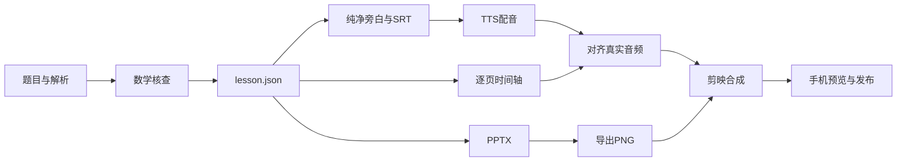

# math-ppt：数学题 → 可编辑 PPT + SRT + 配音时间轴

把数学题图片、参考解析或文字整理为**讲得清楚的数学课程**，输出学生直接观看的 PPT、配音文本、SRT 和逐页时间轴。当前已包含三角函数整数题的 **20 页完整示例**。

## 产物与边界

| 文件 | 用途 |
|---|---|
| `lesson.pptx` | 数学内容优先的可编辑课件，原生 PowerPoint 文字和形状 |
| `lesson.srt` | 完整中文字幕，含逐条起止时间 |
| `voiceover.txt` | 纯净配音文本，与 PPT 演讲者备注一致 |
| `timeline.json` | 每页与每条字幕的对应关系 |
| `lesson.json` | 唯一教案源，供后续修改和批量生产 |

**发布成品不能有**“开头 3 秒抓住数学矛盾”“9:16 竖屏教学”“原题重排”“新增推导”等仅供内部制作使用的文字。这些描述不应进入 PPT 页面、演讲者备注、TTS 配音和 SRT。生成脚本会对常见泄漏关键词做检查。

## 快速运行

使用 Python 3.10+ 与 `python-pptx`：

```bash
git clone https://github.com/1998x-stack/math-ppt.git
cd math-ppt
python -m pip install -r requirements.txt
python scripts/build.py \
  --input examples/tangent-integer-triangle/lesson.json \
  --out examples/tangent-integer-triangle/generated
```

脚本会生成：
```text
generated/
├── lesson.pptx
├── lesson.srt
├── voiceover.txt
└── timeline.json
```

要导出视频用 PNG，可通过 LibreOffice 将 PPTX 转为 PDF，再用 Poppler 的 `pdftoppm` 导出图片。也可以打开 PPT 直接导出每页图片。做字幕、片段和音频对齐时，应以 `timeline.json` 为对应表。

## examples/

示例：[三角形内角的正切值均为整数，求它们的和](examples/tangent-integer-triangle/)。

- [20 页教案 JSON](examples/tangent-integer-triangle/lesson.json)
- [配音纯文本](examples/tangent-integer-triangle/voiceover.txt)
- [SRT 字幕](examples/tangent-integer-triangle/lesson.srt)
- [逐页时间轴](examples/tangent-integer-triangle/timeline.json)
- [原题与数学核查](examples/tangent-integer-triangle/source_verification.md)

答案是 **6**。教案详细讲解最小角不超过 60°、`tan A=1`、剩余两个角为什么是锐角、和角公式、整数因式分解，以及 1、2、4 的迁移判断题。拓展题不会冒充原图片内容。

## 音视频制作流程



初次生成的 SRT 时间由文本长度估算，**不等于与真实 TTS 音频精确同步**。配音生成后应采用逐段音频时长或强制对齐结果重新计算时间戳；不能仅仅根据音频总时长同比缩放就称为逐句精准对齐。

本仓库不会自动生成音频，除非额外接入 TTS 服务。音频合成和最终发布需在视频编辑软件中完成或接入对应 API。

## 项目文件

- [SKILL.md](SKILL.md)：完整 Agent 工作规则、成品约束与质量门槛。
- [scripts/build.py](scripts/build.py)：从教案构建 PPTX、字幕和时间轴。
- [references/audio-video-pipeline.md](references/audio-video-pipeline.md)：TTS 音画对齐与剪辑建议。
- [examples/tangent-integer-triangle/](examples/tangent-integer-triangle/)：包含真实可用数据的完整示范。
- [AGENTS.md](AGENTS.md)：维护与校验规则。

后续可以把不同年级和专题加入各自的 `examples/<topic>/` 目录，保持相同的输入输出契约。